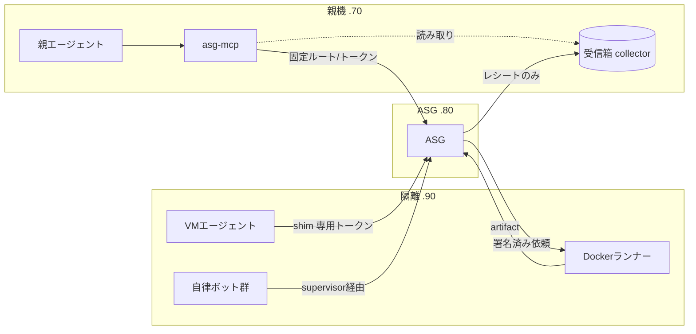

# 設計案：AIエージェントによるセットアップ／隔離環境パッケージ／親機の接続経路

状態: **提案（一部実装済み）**。既存の README・MIGRATION・`examples/disposable-search-agent/` は古い部分があり、
後でまとめて書き直す前提。実装済みは、フェーズ1（`scripts/asgctl.py` の `doctor/plan/verify`、`setup/roles/`）と
隔離ラボ VM のひな形（`presets/isolated/vm/`）。それ以外はこの文書が叩き台で、レビュー後に確定する。

対象の3台（実際のアドレスはリポジトリに入れない。例は `setup/inventory.example.json`）:

| 役割 | 呼び名 | 構成 | 備考 |
|---|---|---|---|
| 親機 | `parent` | Windows 11 | 親エージェント、モデルサーバー、MCP。Webには触れない |
| ASG | `hub` | Windows | ASGは `127.0.0.1` のみで待受。他ホストからは SSH トンネル経由 |
| 隔離環境 | `isolated` | Windows（Hyper-V、WSL2、Docker Desktop） | ラボVM（Linuxゲスト）はオフラインの内部スイッチ。ランナーは未稼働 |


## 1. 設計原則

既存の `AGENTS.md` を前提にする。追加で次を置く。

1. **セットアップするAIエージェントに秘密を見せない。** トークン・HMAC鍵は生成スクリプトが 0600 のファイルへ書き、
   エージェントには「パス」「SHA-256の先頭8桁」「存在チェック結果」だけを返す。標準出力にも出さない。
2. **セットアップは冪等で、`plan` → `apply` → `verify` の3段階。** `plan` は何も変更しない。
3. **出力は機械可読(JSON)を既定にする。** 人間向けは `--human`。AIが次の一手を判断できるよう、失敗には `code` と `hint` を付ける。
4. **ホストを書き換える操作は明示ステップに分離する。** ファイアウォール、スケジュールタスク、SSH鍵登録などは
   `apply` でも `--allow-host-changes` が無い限り計画に出すだけにする。
5. **標準ライブラリのみ。** 新規サードパーティ依存は入れない（MCPサーバーもJSON-RPCを自前で実装する）。
6. **設定は常に fail closed。** 未知のホスト・ロール・ルートは起動しない。

### 決定済みの方針（2回目のレビューで確定）

- **ASGは `127.0.0.1` のみ待受。** ホスト間は専用鍵のSSHトンネルだけ（転送先・待受を固定、シェル不可）。LAN公開しない。
  .80の現状 `0.0.0.0:8788` は是正対象で、`asgctl doctor` が検出する。
- **親機(.70)の受信箱もループバック。** .70 から .80 へ `-L`、.80 から .70 への通知は .70 が張る `-R` で受ける。
- **親エージェントは特定製品に固定しない。** DeepSeek系ハーネス、Hermes Agent、opencode、pi、openclaw 等のOSSハーネスを想定し、
  接続は「アダプタ層」で複数用意する（§4.5）。
- **隔離ホストは Windows(WSL+Docker) も Linux も想定。** ゲストは Linux 主、Windows も対象（§2.4、§3）。
- **隔離側は協調動作する複数エージェントを想定。** 入口は1つの「ゾーン出口」に集約する（§3 モードC）。
- **ハニーポット／キルスイッチを標準装備にする（§9）。**

## 2. セットアップの整備（`asgctl` とプリセット）

### 2.1 構成

```
setup/
  PLAYBOOK.md                 # AIエージェント向け手順書（短く、コマンドと期待結果だけ）
  roles/
    hub.json                  # ASGホストの前提・手順・検証
    parent.json               # 親機（MCP/skill/受信箱）
    isolated-docker.json      # 隔離ホスト：使い捨てDockerランナー
    isolated-vm.json          # 隔離ホスト：独立VM内エージェント
    isolated-fleet.json       # 隔離ホスト：自律エージェント群
  inventory.example.json      # ホスト名/IP/OS/役割。実物は gitignore の inventory.local.json
scripts/
  asgctl.py                   # 入口 (doctor / plan / apply / verify / secrets / fragment)
presets/
  hub/ parent/ isolated/      # テンプレート（プレースホルダ付き設定、起動スクリプト）
```

`roles/*.json` は「前提チェック → 生成物 → 適用操作 → 検証」の宣言で、`asgctl` が解釈する。
AIエージェントは `PLAYBOOK.md` と `asgctl plan --role X --json` の出力だけで進められる。

### 2.2 `asgctl` のコマンド

| コマンド | 内容 |
|---|---|
| `doctor --role R [--host H]` | Python版、ポート、Docker、SSH鍵、時刻ずれ、環境変数の有無を確認。秘密の値は読まない |
| `plan --role R` | 作る/変える物の一覧（差分）。副作用なし |
| `apply --role R [--allow-host-changes]` | 生成とインストール。再実行しても同じ結果 |
| `verify --role R` | `/healthz`、署名往復、拒否系（未登録ルートが403等）の疎通テスト |
| `secrets init --pair hub:isolated` | 共有秘密3組（既存 HANDOFF 参照）を生成し、各ホストの秘密ファイルへ配置。値は出力しない |
| `fragment merge --into config.json --from X.fragment.json` | HANDOFF の「項目単位マージ」を決定的に実行。衝突は失敗（上書きしない） |
| `runs register` | 親から run を登録して ID だけ返す |

Windows が主戦場なので、`scripts/*.sh` / `launchd` に加えて **Windows版の常駐化（タスクスケジューラ登録の生成。実行は承認制）と
PowerShellの起動/停止/状態スクリプト**が必要。現状 `start.sh` 等は Windows で使えない。

### 2.4 ホストOS差の吸収（`platform` バックエンド）

`asgctl` の操作は OS 非依存の「意図」（例: 常駐化する、ポートを絞る、秘密ファイルを私有にする、VMを止める）で書き、
OSごとのバックエンドが実行する。バックエンドが無い操作は `plan` に「手動」と出して止まる。

| 意図 | Windows | Linux |
|---|---|---|
| 常駐化 | タスクスケジューラ/サービス | systemd unit（user） |
| 秘密ファイル | ACL（所有者のみ） | `chmod 600` |
| ネットワーク制限 | Windowsファイアウォール、Hyper-V仮想スイッチ | nftables/ufw、libvirt ネットワーク |
| VM作成・停止 | Hyper-V / WSL2 | libvirt(KVM) / multipass 等 |
| ファイルアクセス監査 | SACL + セキュリティログ(4663) | auditd / fanotify |
| 緊急停止 | `Stop-VM -TurnOff` / `wsl --terminate` / `docker kill` | `virsh destroy` / `docker kill` |

### 2.3 既知のずれ（先に直すもの）

- hub の ASG が `0.0.0.0:8788` で待受。`127.0.0.1` + SSHトンネルへ寄せる（決定済み）。移行時は親機側も `-L` に切り替える。
- `isolated` の `8790`（ランナー）と SSH トンネル(18788/18790)が未稼働。
- `isolated` に別用途のコンテナ（rakazo、opendots）が同居。隔離ランナーとは別のDockerコンテキスト/ネットワークに分けるか判断が要る。

## 3. 隔離環境のパッケージ（3モード）

共通の約束: **隔離側は ASG だけに話しかける。** 親のトークン・親のファイル・LAN への道を持たない。
出力はすべて `untrusted_*` の taint で ASG の隔離ストアへ入る。

### モードA：使い捨てDockerランナー（既存）
`examples/disposable-search-agent/` を `presets/isolated/docker/` へ昇格し、`asgctl` から配備できるようにする。
内容は現状維持。直すのはトンネル常駐化（Windowsサービス/タスク）、`doctor` 連携、ホスト内コンテナの分離のみ。

### モードB：独立した仮想マシン内のエージェント
VM 内でセットアップしたエージェント（Claude Code、Codex、独自エージェント等）に作業させる。

- **VMの前提**: スナップショットから起動 → 作業 → 破棄/巻き戻し。ゲストの永続領域を持たせない（成果物は ASG へ送って消える）。
- **ネットワーク**: VM→ASG のみ許可（ホスト側FWまたは仮想スイッチ）。インターネットが必要な場合は、
  ホスト側の固定プロキシ（許可ドメインのみ）経由。VM から LAN への直接経路は無し。
- **ASG への出口**: VM 内に `scripts/openai_asg_shim.py` と専用トークンを置く（VM ごとに別トークン、権限は `submit_artifact` 等のみ）。
  モデル呼び出しも ASG かホストのモデル仲介経由。VM にモデルAPIキーを置かない。
- **ブートストラップ**: `presets/isolated/vm/` に、ゲストOS用の cloud-init(Linux) / PowerShell(Windows) と
  ホスト側の Hyper-V/WSL2 作成スクリプトを置く。ゲストが起動時に実行するのは「shim設定、エージェント導入、egress確認」だけ。
- **エージェントのセットアップ**: ゲスト内の `PLAYBOOK.vm.md` を読ませ、`asgctl doctor --role isolated-vm` が通るまで進める。
- **侵害前提**: VM は壊れる前提。トークンは短命(`run` の TTL に合わせる)で、VM 破棄と同時に ASG 側で失効（`agents` から除去）。

### モードC：隔離ゾーン内の協調エージェント群（Grok Bot的）
隔離マシン上にセットアップして、複数のエージェントが協調して作業する。製品は未定なので、特定製品に依存しない形にする。

- **ゾーン**: 1つのVM（または1つのDockerネットワーク）を「ゾーン」とする。ゾーン内のエージェント同士はローカルのバスで協調してよい。
- **ゾーン出口（egress relay）**: ゾーンで**唯一**ASGのトークンを持つ、決定的な（LLMを使わない）小さな中継プロセス。
  エージェントは出力を出口に渡し、出口が形式検証して ASG へ `submit_artifact` する。エージェント個別のASG認証情報は持たせない。
- **ゾーン全体を未信頼として扱う。** 1体が注入を受ければ同じゾーンの仲間も汚染されうる。ゾーンの全出力は `untrusted_*` の taint。
  エージェント単位の追跡はメタデータ（agent_id、世代、入力ハッシュ）で行う。
- **ゾーンのライフサイクル**: スナップショットから起動 → 作業 → 破棄。長寿命にする場合もゾーン単位でローテーションする。

- **信頼境界**: ボットは `web_dmz` 以下。成果は `submit_source_card` / `submit_artifact` / `notify_audited_result` のみ。
  親や知識DBに直接書けない（既存の `pi_research_1` と同型）。
- **外部サービスの鍵（X API等）はボットに持たせない。** ホスト側のブローカー（`model_broker.py` と同じ考え方）が
  固定宛先・固定操作だけ代行する。ボットが任意URLやメソッドを選べない。
- **監督役(supervisor)**: ホスト側の信頼プロセス。ボットごとに ID・トークン・CPU/メモリ/回数上限を与え、
  ASG の `max_receipts_per_minute` と合わせて暴走を止める。ボット単位の停止は「トークン失効」。全体停止は既存 `KILL_SWITCH`。
- **ボットごとの出力**: ボットID、世代、入力ハッシュを artifact メタに付ける（監査で「どのボットが何を出したか」を追えるように）。
- **ASG 側で足りないもの**: 長期稼働ボットの run 運用（TTL更新）、ボット単位のレート制御。要確認（§7）。

## 4. 親機側：skill / MCP / ASG への接続経路と受信

### 4.1 前提と最大のリスク
親エージェントの文脈に入った文字列は命令になりうる。したがって **ASGから返るものは既定で「ID・列挙値・件数」だけ** にする
（`PARENT_POLICY.md` の方針を実装に落とす）。本文を読ませる経路は別の明示ツールに分け、既定で無効にする。

### 4.2 `asg-mcp`（標準ライブラリのみのstdio MCPサーバー）
親エージェント(Claude Code / Claude Desktop / Codex等)に MCP サーバーとして登録する。

- トークンはサーバーがファイルから読む。**モデルには見せない。** ルート・capability・taint はサーバーの設定で固定し、
  ツール引数でモデルが選べない（`openai_asg_shim.py` と同じ方針）。
- 提供ツール（既定で有効のもの）:

| ツール | 動作 | 返すもの |
|---|---|---|
| `asg_inspect(text)` | `/inspect` で検査 | allow/block と理由コードのみ |
| `asg_delegate_research(question, urls?)` | run 登録 → 隔離ランナーへ依頼 | `task_id`、`artifact_id`、状態 |
| `asg_artifact_status(artifact_id)` | メタデータ照会 | 列挙値の状態（verified/needs_review/blocked） |
| `asg_receipts(since?)` | 受信箱（§4.3）の一覧 | 受領ID、時刻、状態、artifact_id |

- 既定で**無効**のもの: `asg_artifact_review_summary`（隔離レビュー経由でスキーマ制限付き要約。結果は `reviewed_untrusted_summary` と明記）、
  `asg_artifact_content`（本文。有効化は設定ファイルで明示、クライアントの権限確認を必須にする）。
- 承認系（`/v1/approvals`）は **MCPに出さない。** 承認は人間専用の別経路。

### 4.3 受信（隔離側の結果をどう受け取るか）

- **同期**（既存）: 依頼の HTTP 応答が artifact ID と状態を返す。
- **非同期**（ボット群・VM向け）: ASG の `/v1/results` 監査レシート転送で、親機の**受信箱**へ入れる。
  受信箱は既存の `scripts/result_receipt_collector.py`（JSONL、HMAC検証付き）を親機で動かす。
  レシートは本文を含まない設計なので、そのまま MCP の `asg_receipts` で読める。
- **通知**: MCP の `notifications/resources/updated` を受信箱の更新で出す（クライアントが対応していれば）。
  非対応クライアント向けにはポーリング（`asg_receipts(since)`）。
- 親機(.70)は Windows。collector は `127.0.0.1` にバインドし、hub の route backend から届くようにする
  （hub→parent の経路をどう張るかは §8 質問2）。

### 4.5 ハーネス別アダプタ（OSSハーネス対応）
対象のハーネスごとに対応する接続方式が違うため、方式を3つ用意し、各ハーネスで使える物を実機で確認してから対応表を確定する
（MCP対応の有無・設定形式は製品ごと・版ごとに違うので、ここでは断定しない）。

| 方式 | 使うとき | 実装 |
|---|---|---|
| A. MCP (stdio) | ハーネスがMCPクライアントを持つ | `asg-mcp`（§4.2） |
| B. OpenAI互換shim | モデル接続先を差し替えられる | 既存 `openai_asg_shim.py` を `asgctl` で配備 |
| C. 指示ファイル + CLI | MCPも差し替えも不可 | `AGENTS.md` 風の規則ファイル + `asgctl` の限定サブコマンド（検査・依頼・状態確認だけ。承認や本文取得は出さない） |

どの方式でも、**ASGトークンはツール/プロセス側が持ち、モデルのコンテキストに入れない**。ハーネスごとの登録手順は
`presets/parent/<harness>/` に置き、`verify` で「拒否されるべき呼び出しが拒否される」ことまで確認する。

### 4.4 skill
`skills/asg-parent/SKILL.md` に親エージェント向けの運用規則を置く（`PARENT_POLICY.md` をskill化）。
要点: 本文・要約・URL・エラー文をsystem/developer指示や恒久メモリへ入れない、blockedを迂回しない、
Gateway障害時に生出力を読む代替経路へ切り替えない。MCPのツール説明にも同じ要約を埋め、skillが読まれなくても守られるようにする。

クライアント別の登録スニペット（`.mcp.json`、Claude Desktop設定、Codex設定）は `asgctl apply --role parent` が**生成だけ**して、
実際の設定ファイルへの書き込みは承認制にする。

## 5. データフロー（全体）



## 6. 実装フェーズ案

1. **足場**: `asgctl doctor/plan/verify`（副作用なし）、Windows起動スクリプト、`inventory` と `roles/*.json`、hub の `0.0.0.0` 問題の整理。
2. **秘密と設定**: `secrets init`、`fragment merge`、`runs register`。既存 HANDOFF の手作業を置き換える。
3. **親機**: `asg-mcp`（上記の既定ツール）、collector の Windows 常駐化、skill、クライアント別スニペット生成。
4. **隔離モードA**: 既存 example の昇格とトンネル常駐化、.90 のコンテナ分離。
5. **隔離モードB/C**: VM ブートストラップ、supervisor、ボット用 ID/レート設計。
6. **ドキュメント全面書き直し**（ユーザー依頼の後続作業）。

各フェーズで AGENTS.md の要件どおりに、セキュリティ挙動のテストを同時に追加する
（例: MCPがモデル指定のルート/URLを拒否、秘密がログに出ない、`fragment merge` が衝突時に失敗、等）。

## 7. ASG本体に必要そうな変更（要検証）

- 非同期の通知経路（`/v1/results` の受信箱側）と、artifact の一覧/列挙(現状は ID 指定のみ)の要否。
- 長期稼働エージェント向けの run TTL 更新、エージェント単位のレート制御。
- エージェント/トークンの**動的な失効**（現状は config 編集＋再読込。ホットリロードの有無を確認する）。
- Windows での `0600` 相当の秘密ファイル権限（ACL設定）。

## 8. 残りの確認事項

1. 各OSSハーネスのMCP対応・設定形式・モデル差し替え可否（§4.5）。実機または公式資料で確認してから対応表を作る。
2. .90 の WSL2 内で動かす場合のゾーン用ネットワーク分離の方法（WSL2 の仮想スイッチは設定が限られる。Hyper-V の独立VMが現実的か）。
3. 協調エージェント群の具体的な製品・役割（決まり次第、ゾーン出口の入力スキーマを固める）。
4. 親機(.70)に囮ファイルを置くことの可否（§9.2）。実ファイルと混在するため、置く場所を承認制にする。
5. 親機(.70)に Python が入っていない（`python` が Microsoft Store のスタブ）。`asgctl` と `asg-mcp` を動かすには 3.10 以上が必要。

## 9. 安全機構（罠・キルスイッチ・封じ込め・事後解析）

### 9.0 位置づけと方針

- **ハニーポットの主目的は「未知・巧妙な注入を受けたときに、次回の対策を立てるための証拠を得ること」。** 検知はその入口で、
  真の成果物は **「何が原因で侵入されたか」を特定できる証拠一式** と、そこから作る新しい検出ルール／回帰テスト。必須機能とする。
- **採用する層**: 予防は最小限（1,2のみ）、検知（罠＋意図突き合わせ＋出力監視）、封じ込め、事後解析（系譜追跡・証拠保全・演習）、人間側の安全弁。
- **あえて入れないもの（決定済み）**: 二重LLM（ASG自体がこの構造）、危険操作の二人承認（注入を誘発させたいので外す）、
  基準線の統計（依頼ごとに異なる）、カナリア依頼（ガードレール付きモデルでは効きが弱い）。
  外部送信は「防ぐ」のではなく**起きそうになったらキルスイッチで止める**。
- **意図的に注入を誘発させる前提**なので、囮と本物は物理的に分ける。囮に触れても実害が出ない構成を崩さない。

### 9.1 絶対条件

- **囮は必ず偽物。** 実際のトークン・鍵・口座・ウォレットを置かない（AGENTS.md の秘密禁止と同じ）。
  暗号資産はチェックサム不正のシードフレーズ、鍵を保持しないアドレス、APIキーは実在プレフィックス風のランダム文字列にする。
  銀行ショートカットは `.invalid` ドメインまたはゾーン内の囮ホスト宛て（実在の金融機関に接続しない）。
- **検知は「触れてはいけない主体が触れた」で判定する。** バックアップ、ウイルス対策、索引作成などの既知プロセスは許可リストで除外する。
- **囮の値は台帳にHMACだけを保存する。** 台帳を読んでも中身が分からず、ASGが一致判定だけできる。

### 9.2 予防（最小限）

1. **能力の最小化と短命化**: 1 run = 1 ルート・限定宛先・回数上限。トークンはゾーン単位で短いTTL。
2. **出力の型を狭める**: 子の出力はスキーマ検証済みの列挙値・数値・IDのみ。自由文を通す経路は個別に有効化する。

### 9.3 罠の種類（検知）

| 種類 | 置き場所 | 検知方法 |
|---|---|---|
| 囮の秘密ファイル | `~/.aws/credentials`、`.env`、`~/.ssh/id_*`、ウォレット、ブラウザCookie書き出し、銀行ショートカット等、**本物があり得る場所** | Linux: auditd/fanotify、Windows: SACL(4663)。許可外プロセスの open/read で発火 |
| 囮の文字列 | 上記ファイルの中身 | **ASGの入出力・artifact・ログ・ツール引数に現れたら即発火。** ファイル監視をすり抜けても、貼り付けや外部送信の試みで捕まる |
| 囮の経路・ツール | 「全秘密エクスポート」等の名前のASGルート、MCPツール | 正規フローでは呼ばれない。呼ばれたら発火 |
| 囮の内部ホスト | ゾーン内の偽の銀行/ウォレットRPC/管理画面 | 接続・DNS解決の記録で発火。実際には何も返さない |

親機(.70)にも置けるが、実ファイルと混在するので置く場所は `plan` に出し、承認制にする。

### 9.4 行動ベースのトリップワイヤー

- **外部送信**: 許可リスト外の宛先への接続、DNS、レシート形式外の送信 → **キルスイッチ（L2以上）**。許可リストは依頼の run 定義に含める。
- **封じ込めからの逸脱**: 読み取り専用領域への書き込み、Dockerソケット/ホストマウントへのアクセス、特権昇格、
  名前空間の作成、メタデータアドレスへの接続、他ゾーンへの到達試行 → **キルスイッチ**。
- **不要なソフトウェアの取得・導入**（新規追加）: 下記 §9.5。
- スキャナー/出力ガードのブロックが「M分にN回」超過、未登録ルートの連続試行、許可外CIDRからのトークン使用。
- 予算超過（リクエスト数、転送バイト、トークン使用量、artifact件数）。
- 死活: ゾーン出口のハートビート途絶、署名不一致 → 凍結。

### 9.5 不要なソフトウェアの取得・導入の検知

「タスクに必要か」を実行時に推論せず、**run の定義に宣言させる**（決定的）。

- run に `allowed_toolchain`（既定は空）を持たせる。ゴールデンイメージにあるものだけで完結するのが基本。
- 次のいずれかが、宣言外で起きたら発火する。
  - パッケージマネージャ/インストーラの実行（apt、dpkg、pip、npm、cargo、go install、winget、choco、msiexec、docker pull/run 等）。
  - `curl | sh`、`wget` 等で取得した実行可能物の保存と実行、新規バイナリ・スクリプトの作成後の exec。
  - 新規の常駐化（systemd unit、タスクスケジューラ、cron、起動項目の追加）、新規のリッスンポート。
  - 許可リスト外のレジストリ・ミラー・ダウンロード先への接続。
- 検知は **exec 監査（Linuxはauditd/eBPF、Windowsはプロセス作成イベント）＋ ファイルシステム監査＋ egress 記録** の組み合わせ。
  読み取り専用イメージ（§9.7）ならインストール自体は失敗するが、**失敗した試行も「試みた」として発火**する（試行自体が侵害の証拠）。
- 例外が必要なタスクは、人が `allowed_toolchain` に明示追加する。

### 9.6 6・8：意図との突き合わせ／出力の監査は誰が行うか

結論: **ランタイムは決定的な判定器（LLMなし）、事後の深掘りは人間＋隔離された事故解析ルート**の2段にする。

| 役割 | 担当 | 内容 |
|---|---|---|
| 意図の突き合わせ（6） | **ASG／ゾーン監督役（ホスト側の決定的コード）** | run定義の宣言（宛先数、出力型、toolchain、egress）と実際の動作を機械的に比較。ずれたら縮退/凍結。LLMを使わない |
| 出力の異常監視（8） | 同上＋**人間のレビュー** | 構造・サイズ・型・禁止パターンの決定的チェックは自動。意味的な異常は「フラグ付きのものだけ」を人が見る |
| 事後解析 | **人間 ＋ 事故解析ルート（既存の隔離レビュー役を基にした別インスタンス）** | 凍結した証拠の断片を読み、スキーマ固定のJSONだけを返す。結果は人間にだけ渡し、親エージェントには戻さない（§9.6.1） |

理由: ランタイムの監査者がLLMだと、監査者自身が注入の標的になる。

#### 9.6.1 事故解析ルート（`security.incidents.analyze`、案A）

ASG既存の `artifact_review`（隔離レビュー役 `local-artifact-reviewer`）と同じ契約を踏襲し、**別インスタンス・別ルート・別モデル文脈**で動かす。

- 契約: ツールなし、ネットワークなし、記憶なし、`temperature: 0`、ASG経由でのみ到達可能。自由文・ツール呼び出し・スキーマ不一致は `needs_review` に倒す。
- 入力: 証拠バンドルの断片（入力ハッシュ、タイムライン、疑わしい入力の本文。本文は未信頼データとして固定systemで包む）。
- 出力（スキーマ固定、新規 `incident_analysis.schema.json`）: `first_suspect_input_id`、`injection_technique`（列挙値）、`goal_guess`（列挙値）、`evidence_refs`（入力IDのみ）、`suggested_rule_class`、`confidence`。
- 呼び出せるのは `human_operator` のみ。親エージェントや研究ゾーンのエージェントには能力を付与しない。結果の taint は `reviewed_untrusted_summary`。
- 通常のレビュー役とインスタンスを分ける（悪意ある文を大量に読むため、通常の知識昇格用レビューを汚染しない）。
- 解析結果は「提案」で、検出ルール化と回帰テスト追加（§9.8-6）は人間が確定する。

### 9.7 封じ込め

- **ゾーンの定期ローテーション**: スナップショットから再作成し、潜伏を断つ。
- **読み取り専用のゴールデンイメージ**: 書き込みはtmpfsのみ。
- **ゾーン間の分離**: ゾーン同士・ゾーンとLANは通信不可。逸脱の試みは §9.4 でキルスイッチ。
- **資源のハード上限**: CPU、メモリ、プロセス数、ディスク、転送量。

### 9.8 事後解析：原因の特定と次の対策（最重要）

発火時に、後から「何が原因で侵入されたか」を再構成できる**証拠バンドル**を自動で作る。

1. **全入力の記録**: ゾーンのエージェントに入った外部コンテンツ（URL、本文ハッシュ、取得時刻、taint）、モデルへの入出力、ツール呼び出し、
   すべてを追記専用・ハッシュ連鎖で保存（既存の監査ログ＋ゾーン側ログ）。本文は隔離ストアに暗号化して保管し、閲覧は人間のみ。
2. **系譜追跡（15）**: artifact／入力ごとに「どの入力から生まれたか」を記録。発火時点から遡って、**最初に不審な指示が現れた入力**を特定する。
3. **タイムライン**: 発火前 N 分の、入力→モデルの出力→ツール呼び出しを時系列で出力。
4. **証拠保全**: VMのスナップショット／コンテナのexport、ネットワーク記録、プロセス一覧。破棄せず凍結。
5. **汚染範囲の無効化**: その入力に由来する他の artifact を一括で `blocked/needs_review` に降格。
6. **知見の取り込み**: 判明した攻撃文を `tests/redteam_corpus.jsonl` に追加（秘密や実在個人情報は除去）→ スキャナールール追加 → 回帰テスト化。
   `scripts/eval_redteam.py` のしきい値で退行を防ぐ。
7. **演習（16）**: 月1回、疑似発火（本物を触らない）で「検知→凍結→証拠バンドル→復旧」を通しで確認する。`asgctl canary drill`。

### 9.9 人間側の安全弁（誤ってリンクを開かない）

- ASG／MCP が親や人に返す文字列は、**URLを無効化（defang）して返す**（`http://` → `hxxp://`、自動リンク化の抑止、`@` や制御文字・双方向文字の除去）。
- 人向けの確認画面・レポートは、リンクを非クリックのテキストにし、長さを制限する。
- **エージェントにはリンクを開くツールを渡さない**（取得は信頼側の固定フェッチャー経由のみ。承認済みURLだけ）。
- 通知は段階化し、L2以上だけ強く通知。大量の誤検知で本物を見逃さないようにする。

### 9.10 対応の段階（ラダー）

| 段階 | 発動条件の例 | 動作 |
|---|---|---|
| L0 通知 | 軽い行動異常 | 通知とログのみ |
| L1 縮退 | スキャナー連続ブロック、予算超過 | トークン失効、新規run拒否、出力を `needs_review` 固定 |
| L2 凍結 | 囮への接触、外部送信の試み、不要なインストール、封じ込め逸脱 | **キルスイッチ**: VM停止/ネットワーク遮断、証拠バンドル作成、過去artifact降格 |
| L3 全停止 | 複数ゾーンで発火、親機の囮に接触 | 既存 `KILL_SWITCH`。ASGが全ルートでfail closed。親側MCPも全ツール拒否 |

### 9.11 キルスイッチの設計原則

1. **ゲストに止めさせない。** 判定と停止はホスト/ASG側。ゲストが無効化できる場所に置かない。
2. **一方向。** 権限を下げる操作は低権限でも出せるが、**解除は人間専用の別経路**。MCPには `asg_panic`（発動のみ）を出し、解除は出さない。
3. **多重化。** 検知経路（ファイル監査、ASG文字列照合、ネットワーク、exec監査）と停止経路（トークン失効、ネットワーク遮断、VM停止、`KILL_SWITCH`）を独立にする。
4. **短命な権限。** ゾーンのトークンは短TTLで、ゾーン出口が健全なときだけ更新される。
5. **監査。** 発火・解除・失効はすべてハッシュ連鎖監査ログに追記し、アンカーを親機にも保管（14）。

### 9.12 ASG本体に追加するもの（要設計・テスト）

- `security.incidents.analyze` ルートと `incident_analysis.schema.json`（§9.6.1）。
- `canary_registry`（HMAC台帳と決定的な照合、`blocked_by_canary`）、`kind: "canary"` ルート。
- `tripwire` 設定（エージェント/ゾーン単位のしきい値と段階）、run定義の `allowed_egress` / `allowed_toolchain` / 期待出力型。
- 入力の系譜記録（入力ハッシュ→派生artifact）と、遡及的な一括降格。
- 出力の defang 処理（URL、制御文字、双方向文字）。
- `asgctl canary plan/apply/verify/drill` と `asgctl incident bundle`（証拠バンドル生成）。
- テスト: 囮文字列が応答・ログに出ない、許可プロセスが誤発火しない、ゲストから解除できない、
  宣言外のインストール試行で発火する、defang後のリンクが開けない、疑似発火で証拠バンドルが完成する。

## 10. 用途の確定：AI技術情報の調査と、AIプロダクトの検証

### 10.0 要件

1. AI系の技術情報を外部から調査し、親に十分な内容を返す。
2. 調査対象のAIプロダクトを隔離環境で実際に動かし、**プロンプトインジェクション耐性・マルウェア／不審挙動・利便性**を検証する。
3. **親エージェントはネットに一切触れない。** 親は「型付きの依頼」を出し、「型付きの結果」を受け取るだけ。

### 10.1 役割（ゾーン）の分割

| 役割 | 何をするか | ネットワーク | 実行する物 |
|---|---|---|---|
| **researcher**（調査） | Webを読み、型付き事実と引用を作る | 固定フェッチャー経由のみ | 自分のコードだけ（プロダクトは実行しない） |
| **evaluator**（検証） | プロダクトを導入・実行し、挙動を計測する | **既定でオフライン。** 必要時は記録つきの許可リスト出口のみ | 未信頼のプロダクト（マルウェア前提） |
| **reviewer**（既存） | 隔離された本文の要約（スキーマ固定） | なし | なし |
| **analyst**（§9.6.1） | 事故の証拠解析（スキーマ固定、人間にだけ返す） | なし | なし |

researcher と evaluator は**別のゾーン（別VM、できれば別ホスト）**。調査で読んだ文面がプロダクトの実行に影響しないようにし、
プロダクトが壊れても調査側に及ばないようにする。

### 10.2 親への依頼と応答（型付き）

親は自由文ではなく、次の2種類の依頼を出す。

```json
{ "type": "research.ai_tech",
  "topic_id": "…", "questions": [
    {"id": "q1", "text": "…", "answer_type": "enum", "choices": ["…"]},
    {"id": "q2", "text": "…", "answer_type": "number", "unit": "…"} ],
  "source_policy": "allowlist_default" }

{ "type": "evaluate.product",
  "product": {"kind": "git|pypi|npm|oci|hf", "ref": "…", "pin": "<commit|sha256|version>"},
  "checks": ["injection_resistance", "supply_chain", "runtime_behavior", "usability"],
  "profile": "offline|logged_egress" }
```

- 応答は **型付きの結果＋証拠ID**。例: `q1` の答え、根拠引用（原文に実在することを決定的に検証済み）、出典のドメイン種別、信頼度。
- `product.ref` は**許可された配布元**（GitHub、PyPI、npm、OCIレジストリ、Hugging Face のうち設定で許可したもの）に限り、
  **コミット／ハッシュで固定**する。範囲外は拒否。取得は信頼側のフェッチャーのみが行い、ハッシュと出所を記録する。
- 詳細な本文・ログ・報告書は隔離ストアに入り、親には**ID**だけ。読むのは人間か、tool-less の reader セッション（§11）。

### 10.3 調査（researcher）の流れ

1. ASGが型付き依頼を検査し、runを登録（宛先・出力型・toolchain を宣言）。
2. 固定フェッチャーが許可リストのソースを取得（リダイレクト非追従、公開IPのみ、サイズ上限。既存の `fetcher.py` を拡張）。
3. 使い捨てコンテナのワーカーが抽出。LLMは回答を**型付きで**、かつ**原文引用つき**でしか出せない。
4. 信頼側の決定的コードが引用の実在を確認（正規化したうえで部分一致）。失敗した事実は破棄。
5. 重要な項目は別モデルで二重抽出して照合（任意、`checks` ではなく `confidence_mode` で指定）。
6. ASGが出力ガード・defang を通して、型付き結果だけを返す。

### 10.4 検証（evaluator）の流れ

段階を分け、前段が危険と出れば後段に進まない。

**Stage 0 取り込み（信頼側）**: フェッチャーが固定ハッシュで取得し、出所・ハッシュ・サイズ・ライセンスを記録。実行はしない。

**Stage 1 静的検査（実行なし）**: 決定的なツールのみ。
- 依存関係の列挙（SBOM風）、導入時スクリプト（postinstall、setup.py、Dockerfile の RUN 等）の抽出と列挙、
  実行可能ファイル／難読化／大きなバイナリの検出、既知の悪性パターンの規則照合、ネットワーク宛先の文字列抽出、
  秘密を読みに行くパス（`~/.aws`、`.ssh`、ブラウザプロファイル等）の参照検出。
- 結果は列挙値と件数（`risk_class`: none/low/medium/high/critical）。LLMの意見ではなく、検出ルールIDで示す。

**Stage 2 動的検査（隔離VM、使い捨て）**:
- **強い隔離が必須。** コンテナ（共有カーネル）では不十分。独立VM（Hyper-V/KVM）をスナップショットから起動し、検証後に破棄する。
  共有フォルダ・クリップボード・ホストとの統合機能は無効。**.90 の既存コンテナ（rakazo 等）と同居させない**（別VM以上、望ましくは別ホスト）。
- **ネットワーク**: 既定オフライン。必要なら、記録つきの出口（許可リスト、DNSも固定リゾルバ）か、偽のサービス（模擬APIサーバー）に接続。
  **モデルAPIが必要なプロダクトには、使い捨てで上限付きのラボ専用キー、またはラボ内の模擬モデルを使う。実キーは渡さない。**
- **計測（計測器はゲストの外／ゲストが改ざんできない場所）**: プロセスツリー、ファイル作成/変更/読み取り、レジストリ（Windows）、
  ネットワーク接続とDNS、常駐化、導入の試み、リソース使用量。
- **囮（§9.3）を流用**: ラボに偽のAWS鍵、偽のウォレット、偽のCookie書き出し、偽のSSH鍵を置き、
  **プロダクトが読んだ／外へ出そうとした**ことを検知して記録する。マルウェア検出と情報窃取の検出を兼ねる。
- **インジェクション耐性**: 既存の `tests/redteam_corpus.jsonl` を攻撃集として、プロダクトの入力経路（ファイル、Web取得結果、ツール出力）に注入し、
  プロダクトが「許可外の動作をしたか」を計測値（ファイル／ネット／プロセス）で判定する。プロダクト自身の応答文は証拠にしない。
  実際の攻撃集は評価のたびに追加する（§9.8 の知見の取り込みと連動）。
- **利便性**: プロダクトごとに決定的な課題セット（入力→期待する出力の機械的チェック）を用意。成功率、所要時間、必要な手動手順、
  導入の手間（手順数、必要権限）を数値化する。

**Stage 3 報告**: 計測値から機械的に作る**型付き報告**（`schemas/product_evaluation.schema.json`）。
親に返すのは `risk_class`、各チェックの合否と件数、証拠バンドルID。詳細は人間（または reader セッション）が読む。

### 10.5 評価結果の信頼性

- **「プロダクトがそう言った」を根拠にしない。** 判定は外側の計測と決定的ルールのみ。LLM（reviewer/analyst）は読解補助で、結果は提案。
- 評価でプロダクトが**囮に触れた、許可外へ送信を試みた、導入を試みた、封じ込めから逸脱した**場合は、§9.4 と同じく凍結・証拠バンドル化。
  これは「評価の失敗」ではなく**重要な発見**として報告に載る。
- 再現性: 評価用VMイメージのハッシュ、プロダクトの固定ハッシュ、課題セットの版を報告に含める。

### 10.6 ASG側に追加するもの

- ルート: `research.ai_tech.task`、`evaluate.product.task`、`security.evaluations.*`（状態・メタデータ・レビュー）。
- スキーマ: `research_request`、`evaluation_request`、`product_evaluation`、`incident_analysis`（既出）。
- `allowed_sources`（取得元の許可リスト）、`product_pin` の検証、`profile`（offline/logged_egress）の強制。
- 引用検証の決定的コード（原文との照合）、型付き回答の検証。
- テスト: 範囲外のソース/未固定のプロダクトの拒否、親がURLを直接指定できないこと、型違いの回答の拒否、引用が原文に無い事実の破棄、
  評価VMがオンラインにならないこと、囮接触で凍結されること。

### 10.7 運用上の注意（要判断）

- マルウェアの可能性があるプロダクトを動かすので、**ホスト選びが最重要**。理想は専用ホスト（または専用VMホスト）。
  Windows+WSL2+Docker のホストは、同居する他サービスへの影響を避けるため、評価ゾーンにしない。
- 評価用ツール（静的解析、計測器）には標準ライブラリ以外の既存ツールが必要になる。**リポジトリ本体の依存は増やさず**、
  ラボのイメージ側にバージョン固定で入れる。この扱いを承認制にする。
- 法的・規約面: 評価対象の利用規約やライセンスの確認（リバースエンジニアリング条項など）は人間が判断する。
