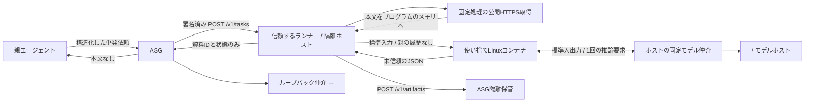

# 使い捨て検索子エージェント：Docker + Agent Security Gateway

**隔離ホストで子コンテナを作り、ASGホストのAgent Security Gateway（ASG）を通して依頼と結果を受け渡すひな形です。**

ASGの検査に`<INSPECTOR_MODEL>`、子の推論に`<WORKER_MODEL>`を使う構成例です（モデル名は導入環境に合わせて運用者が選びます）。モデルの接続先は、信頼ホスト側の環境変数`MODEL_BROKER_HOST` / `MODEL_BROKER_PORT`で、モデル名は同じく信頼ホスト側の `MODEL_BROKER_INSPECTOR_MODEL` / `MODEL_BROKER_WORKER_MODEL` で選びます（呼び出し側や子コンテナからは変更できません。未設定・不正なら推論は失敗側に倒れます）。ASG（hub）側 `llm_inspector.model` とリレー側で許可する inspector モデル名は一致させてください。一致しないと検査が error になり、`fail_closed=true` の場合は委任が入力ガードで止まります。記載したWindows配置先は参考値です。依頼受付、公開Web取得、コンテナ実行、ASGへの隔離保管まで実装しています。

## 構成



ASGとの通信はランナーが担当します。子にはASGトークン、署名鍵、検索APIキー、SSH鍵、Dockerソケット、親のファイルを渡しません。ランナーはDockerを操作できる信頼側のプログラムです。

## 何を隔離するか

| 対象 | 既定の動作 |
|---|---|
| 子の会話・ファイル | 毎回新規コンテナ。終了時に削除。作業領域`/tmp`は64 MiBの一時メモリ |
| 子の権限 | UID 65532、capability全削除、権限昇格禁止、ルートFS読取専用 |
| 子の通信 | `--network=none`。インターネット・LAN・ASGへ直接接続不可 |
| リソース | CPU 1、メモリ512 MiB、PID 64、ホスト監視100秒、イメージ内120秒 |
| 検索 | LLMを使わない固定処理。公開HTTPSのGETのみ。任意ヘッダー・POST・ツール実行なし |
| 内部アクセス | 取得先のDNS全回答を検証。非公開・特殊IP拒否。検証済みIPにTLS接続を固定 |
| リダイレクト | 追跡しない。認証情報の転送・内部URLへの転送を防ぐ |
| 親へ返す情報 | ランナー生成の状態、件数、ASG資料IDのみ。本文・URL・タイトル・要約を返さない |
| 監査・保存 | ASGに未信頼の報告を隔離保管。ローカルDBには依頼のハッシュと受領情報のみ |

**Dockerだけでプロンプトインジェクションを防ぐことはできません。** このひな形は「子が侵害されても任意の文章を親のコンテキストへ戻さない」ことを既定の境界にします。子による資料選択・抽出の誤りは残ります。JSONの形式検証やASGの`verified`は、文章の安全性・事実性を保証しません。

親が自然言語の回答を読む場合は、その経路にも別途方針が必要です。ASGの隔離レビュー経路を使っても、要約は未信頼データとして扱ってください。**完全に影響をゼロにする要件と、外部由来の自由文を親に読ませる要件は両立しません。**

## ファイル

- `Dockerfile` / `compose.yaml`：Linux子コンテナと実行制限。
- `runner.py` / `runtime.py`：署名済み依頼の受付、使い捨て実行、期限・出力上限。
- `gateway_link.py`：ASGのHMAC検証とartifact送信。ASG応答の自由文を除外。
- `fetcher.py`：公開ページ取得。必要に応じてBrave Search APIでURL候補を取得。
- `worker.py`：HTML抽出とモデル推論要求、結果の形式検証。参照アダプターも付属。
- `model_broker.py`：ホスト専用。送信先・モデル・会話形式を固定した推論仲介。
- `inspector_relay.py`：ASGホスト専用。`<INSPECTOR_MODEL>` への固定接続をループバックで提供。
- `contract.py`：入出力の許可フィールド・型・長さの検証。
- `asg/`：ASGホスト担当者向け設定差分と依頼例。
- `PARENT_POLICY.md`：親の連携ルール。
- `tests/`：境界テスト、ASG実装との互換テスト、実コンテナの検査。
- `VALIDATION.md`：今回実施した検証と未確認項目。

## 1. 隔離ホストの前提を確認

必要なもの：Python 3.12以上、Docker CLI、稼働中のDocker Linuxエンジン、OpenSSHクライアント。追加のPythonパッケージは不要です。

今回のSSH先はWindowsホストです。`<ユーザー>@<隔離ホストのアドレス>`で接続します。Docker Linuxエンジンを起動し、ホストランナー用のPython 3.13.15を専用フォルダーへ配置しました。WSLのUbuntuは26.04.1 LTSです。子イメージは`python:3.12-slim-bookworm`を使います。

Windowsでの配置例は`C:\Users\User\Documents\disposable-search-agent`、Pythonは`C:\Users\User\Documents\disposable-search-runtime\python.exe`です。自動起動は各ホストで設定します。このリポジトリをコピーするだけでは、OSの起動タスクや認証情報は設定されません。

配置先フォルダーを開き、以下を実行します。Windowsでは`python`を実際のPython実行ファイル、Linuxでは必要に応じて`python3`へ読み替えます。

```powershell
python --version
docker version --format '{{.Server.Os}} {{.Server.Arch}}'
docker compose config --quiet
docker compose build worker
python runner.py demo
python tests/smoke_docker.py
```

環境変数`WORKER_ADAPTER`未指定の`demo`はネットワークもASGも使いません。`WORKER_ADAPTER=qwen`（アダプター選択子の名前であり、モデル名ではありません）を設定するとホスト経由で `<WORKER_MODEL>` へ接続します。意図的に命令文を含めた架空の資料を子へ渡し、親への出力に本文が入らないことを確認します。

`docker compose up`で子を常駐させる必要はありません。本番ランナーは依頼ごとに`docker run --rm`で同じ制限を設定します。イメージは信頼側だけでビルドし、親の設定・秘密ファイルはビルドコンテキストに含めません。`.dockerignore`は許可した3ファイルだけを含めます。

## 2. ASGホストとの通信

既定はSSHトンネルです。ホストのHTTPポートをLANに公開する必要はありません。

隔離ホスト上で、以下を別のターミナルから実行します。`ASG_SSH_USER`はASGホストで使用する実際のSSHユーザー名に置き換えます。ASGホストのSSH設定でTCP転送が許可されている必要があります。

```powershell
ssh -N -o ExitOnForwardFailure=yes -o ServerAliveInterval=30 -o ServerAliveCountMax=3 -L 127.0.0.1:18788:127.0.0.1:8788 -R 127.0.0.1:18790:127.0.0.1:8790 ASG_SSH_USER@<ASGホストのアドレス>
```

| 接続 | 用途 |
|---|---|
| 隔離ホスト側 `127.0.0.1:18788` → ASGホスト側 `127.0.0.1:8788` | ランナーからASGへartifactを送る |
| ASGホスト側 `127.0.0.1:18790` → 隔離ホスト側 `127.0.0.1:8790` | ASGからランナーへ依頼を送る |

今回のASG実ポートは8788です。実環境では専用鍵と固定済みホスト鍵を使い、シェル実行を禁止、転送先を`127.0.0.1:8788`、逆転送の待受を`127.0.0.1:18790`へ制限しています。専用鍵の登録はユーザーの明示承認を得て実施しました。

既存のTLS/VPN構成を使う場合、ランナーのASG接続先は`ASG_BASE_URL=https://...`で指定できます。HTTPを許す接続先はループバックだけです。ランナーの待受は常に`127.0.0.1`です。

## 3. ASG側の設定

詳細は `asg/HANDOFF.md`。`asg/config.fragment.json`を**既存設定へ項目単位でマージ**します。既存の`agents`・`routes`全体を上書きしないでください。`controller`は仮の親エージェントIDです。

必要な認証情報は次の3種類です。実値はこの配布物に含みません。

| 用途 | ASGホスト | 隔離ホスト |
|---|---|---|
| ASGからランナーへの認証 | 環境変数 `ASG_SEARCH_BACKEND_KEY` | 同じ値を `SEARCH_BACKEND_TOKEN` |
| ASG署名の検証 | `backend_hmac_key_env`が参照する既存鍵 | 同じ値を `ASG_BACKEND_HMAC_KEY` |
| ランナーからASGへの送信 | `agents.lab_worker.token_sha256`にSHA-256 | 元トークンを `ASG_WORKER_TOKEN` |

キーはそれぞれ32文字以上の空白を含まないASCII文字列を使用します。共有する組を除き別々の秘密値にしてください。子コンテナへ渡さないでください。親用トークンを子用へ流用しないでください。

これらをOS側の環境変数へ安全に設定したうえで、隔離ホスト上で起動します。このひな形は`.env`を自動読込しません。

```powershell
$env:ASG_BASE_URL = 'http://127.0.0.1:18788'
$env:ASG_ALLOWED_CALLERS = 'controller'
python runner.py serve
```

`ASG_ALLOWED_CALLERS`は実際の親IDに合わせます。カンマ区切りで複数指定できます。秘密の未設定時は起動を拒否します。全サービスの時刻を同期してください。署名の許容時間差は120秒です。

## 4. Gatewayから依頼する

親側でrunを登録し、`asg/run-registration.example.json`の2経路・2callerを同じrunに含めます。登録権限は親にだけ付与します。

依頼例は `asg/task.example.json`。取得したrun IDへ置換し、ASGの`POST /v1/tasks`へ送信します。認証ヘッダーは以下です。

```text
Authorization: Bearer <親のASGトークン>
X-ASG-Route: lab.web_research.task
X-Agent-Capability: delegate_web_research
Content-Type: application/json
```

`task_id`はrun内で一意にしてください。同じrun/taskと同じ本文の再送は、処理完了済みなら保存した受領情報を返します。処理途中・失敗後・本文を変更した同じIDの再送は409で拒否します。転送や保管が成功したか不明なときに自動再実行することを防ぎます。再起動後も判定用DBが残ります。

成功応答には次のような情報だけが含まれます。

```json
{
  "version": 1,
  "status": "stored",
  "artifact_id": "art_00000000000000000000000000000000",
  "artifact_status": "verified",
  "source_count": 1,
  "fetch_failures": 0,
  "external_text_returned": false
}
```

`artifact_status`は`verified`・`needs_review`・`blocked`のいずれかです。`stored`は保管の完了を表し、`blocked`であっても本文を親へ転送しません。ASG停止・認証失敗・不正応答時も、生の子出力へ切り替えることはありません。

## 5. 検索の使い方

- **URL指定**：`inputs`に最大5個の公開HTTPS URLを指定。APIキー不要。
- **検索語から探す**：`constraints.search=true`、`inputs=[]`。`task.objective`を検索語としてBrave Search APIに送る。ランナーの環境変数`BRAVE_API_KEY`が必要。
- `allowed_hosts`は完全一致のホスト名の許可リスト。空配列なら、公開IP条件を満たすHTTPSホストが対象。
- 一度に最大5件。1ページ256 KiB、コンテナへ渡す本文は1ページ70,000文字まで。取得処理全体の上限は75秒。

初期版はHTML・プレーンテキスト・Markdownのみです。JavaScript実行、ログイン、Cookie、PDF、添付ファイルの実行、リダイレクト、自律的な追加検索は実装していません。大きなページや転送されるURLは失敗件数に入り、全件失敗なら依頼を失敗として返します。文字コードはUTF-8として扱います。

## 6. 接続済みのLLM

本番ランナーは`WORKER_ADAPTER=qwen`（アダプター選択子）で起動します。子が抽出した1ページ最大4,000文字を、標準入出力経由でホストの`model_broker.py`に渡します。ホストは質問・資料ID・入力形式・長さを検証し、固定した `<WORKER_MODEL>` へ1回だけ推論を依頼します。結果を子とホストの両方で検証し、自由文はASGへ保存します。

子にはネットワークを追加していません。送信先URL、モデル、ツール、シェルコマンドを子が選ぶことはできません。各依頼は固定systemメッセージとその依頼の資料だけを送り、過去の会話を送信しません。モデルサーバー自身の記録・保持設定は、このランナーの制御範囲外です。

ASGは`127.0.0.1:14000/v1`のホスト内仲介を通して、モデルサーバーの `<INSPECTOR_MODEL>` を呼び出します。モデルサーバーの認証要否は導入環境によります（認証情報が必要な場合は信頼ホスト側で扱い、子には渡しません）。検査は`fail_closed=true`で、モデル障害時は転送を拒否します。既存の決定的な検査を先に実行し、LLMに既存の拒否を解除させません。

ASGホストへ`contract.py`、`model_broker.py`、`inspector_relay.py`を同じディレクトリに配置し、そこで`python inspector_relay.py`を起動します。`asg/inspector.fragment.json`の`llm_inspector`をASG設定へマージし、検査仲介の起動を確認してからASGを再起動してください。モデルサーバーへの認証が必要な場合はホスト側仲介で実装し、子にキーを渡さないでください。

守る境界：

1. 親の履歴、system prompt、認証情報、ホームフォルダーを子へ渡さない。
2. 毎回新しいモデルセッションを使い、メモリ・会話・ツール状態を次の依頼へ再利用しない。
3. モデルの提案からホスト上のコマンド・Dockerオプション・送信先URLを生成しない。
4. ローカルモデルを子に同梱するか、専用の限定された推論仲介を設計する。外部モデルAPIを使うために子へ直接ネットワークや親のAPIキーを渡さない。
5. 自律検索を追加する場合も、子は限定された検索要求を出すだけにし、信頼側が回数・取得先・入力長を検証する。
6. 自由文の結果はASGに隔離し、親への受領情報のフィールドを増やさない。

GPU・モデル重みは`モデルホスト`側のサービスが担当します。子コンテナへのGPU権限や重みのマウントは不要です。

## 7. 運用上の境界

Dockerはホストとカーネルを共有します。カーネル脆弱性まで含む強い隔離が必要なら専用VMなどを追加してください。Linux上ではrootless Dockerを検討できます。既存Docker全体の設定はこのひな形では変更しません。

HTMLの解析は子で行い、ホストの取得処理はPython標準ライブラリのHTTP/TLS・文字列処理に限定しています。取得処理の実装自体やランナー・ASGホストが侵害されるケースは別の境界です。必要に応じてネットワーク機器でもホストの外向き通信を制限してください。

通常終了・タイムアウト・Ctrl+Cでは子を削除します。Dockerデーモン障害やホスト強制停止時は後処理を保証できません。復旧時は次で残存一覧を確認し、対象名を確認して削除します。コンテナ内の120秒タイマーは追加策であり、任意コード実行を許す将来の子に対して改変不能な監視ではありません。

```powershell
docker ps -a --filter label=local.disposable-search=true
docker rm -f <確認したdisposable-search-から始まるコンテナ名>
```

ASGの隔離ストアと監査ログは保持されます。使い捨てなのは子の実行環境です。保持期間・GCはASGホスト側で設定してください。親の作業フォルダーに資料をダウンロードし、自動読込やインデックス登録する運用は避けてください。

コンテナのベースイメージは保守しやすいタグ指定です。本番の再現性が必要な場合、確認した`python:3.12-slim-bookworm`のdigestへ固定し、更新時に実コンテナ検査を再実行してください。

## 検証コマンド

```powershell
python -m unittest discover -s tests -v
python tests/check_asg_compatibility.py <agent-security-gatewayのローカルcloneパス>
python tests/smoke_docker.py
```

互換テストはASGを一時ディレクトリとループバックで起動します。ASGホスト、実際のAPIキー、外部検索APIは使いません。ASGの実コードによる署名・経路・隔離保管・出力ガードを検査し、Web取得とDocker実行だけを代替します。

## 参照

- [Agent Security Gateway](https://github.com/momiji-manjyuu/agent-security-gateway)、確認コミット `e9a251de9b8ac26112376e78f542d8110f14b7db`。
- [Docker: none network](https://docs.docker.com/engine/network/drivers/none/) / [Docker Engine security](https://docs.docker.com/engine/security/)。
- [OWASP: Prompt Injection Prevention](https://cheatsheetseries.owasp.org/cheatsheets/LLM_Prompt_Injection_Prevention_Cheat_Sheet.html) / [SSRF Prevention](https://cheatsheetseries.owasp.org/cheatsheets/Server_Side_Request_Forgery_Prevention_Cheat_Sheet.html)。
- [Brave Search API](https://api-dashboard.search.brave.com/app/documentation/web-search/get-started)。検索APIの契約・キー設定は別途必要です。
